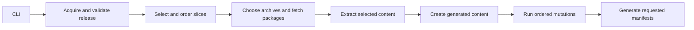

# Preface

This document covers the core internal packages and the carving pipeline in the `internal/` directory.

IMPORTANT: Read the `.kb/agents.md` file.

# Concepts

## Scope

The `internal/` directory houses the core business logic, components, and utilities of Chisel. It coordinates slice selection, dependency resolution, package fetching, file extraction, filesystem mutations, and manifest output. These packages are not part of Chisel's public API and must not be imported by external consumers.

## Pipeline

Chisel's carving pipeline is coordinated by `slicer/`:

